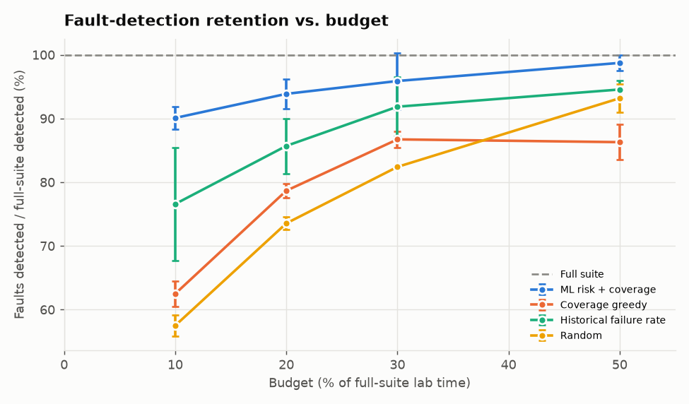
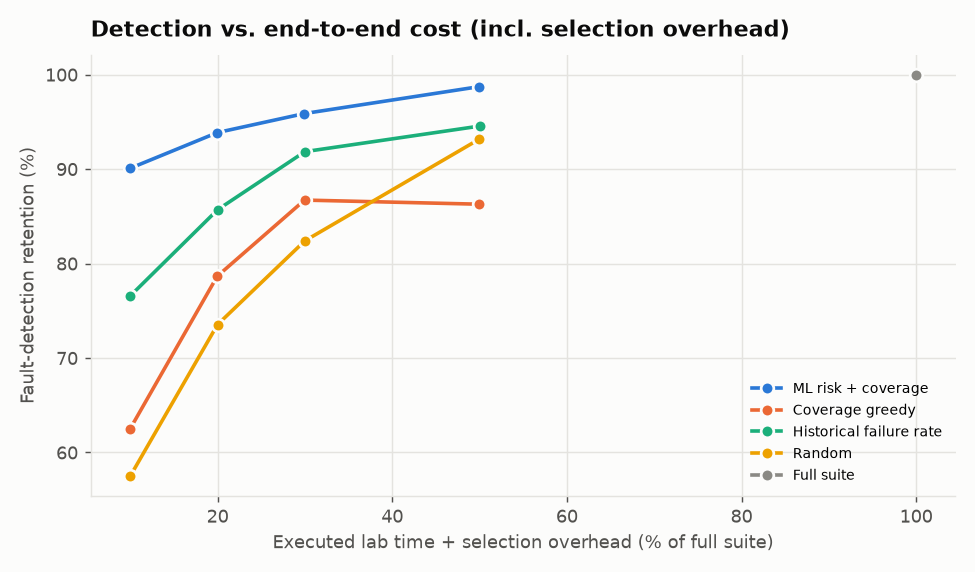
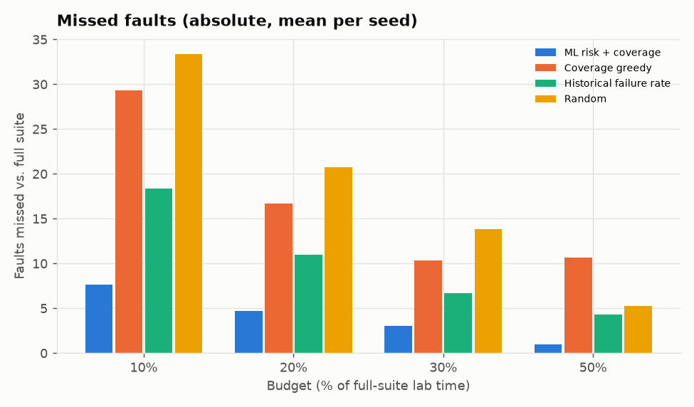
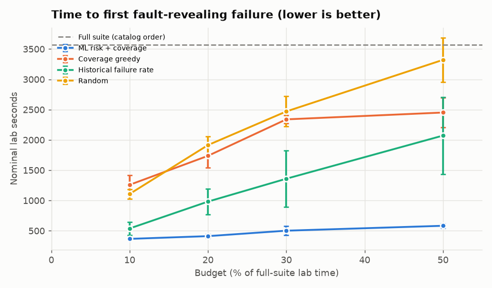
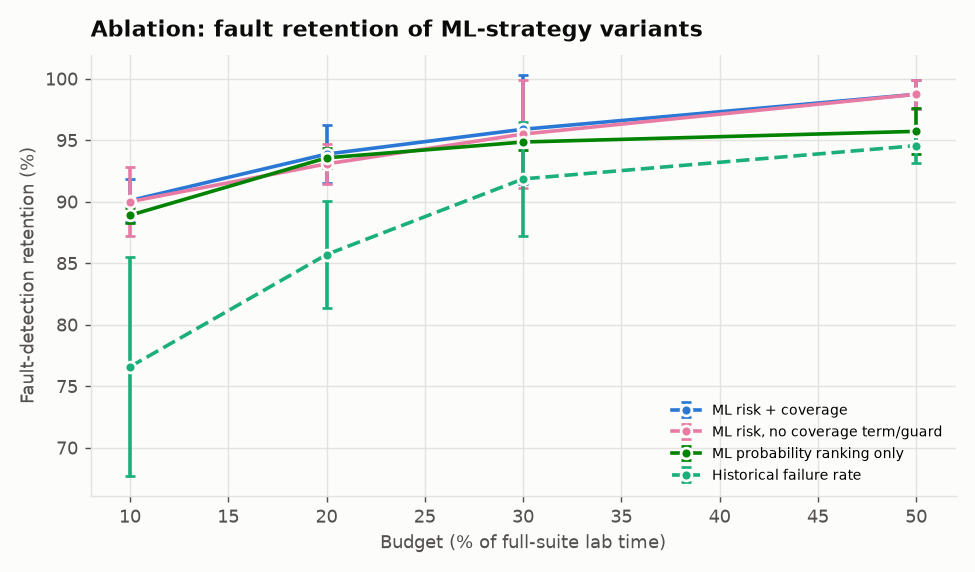
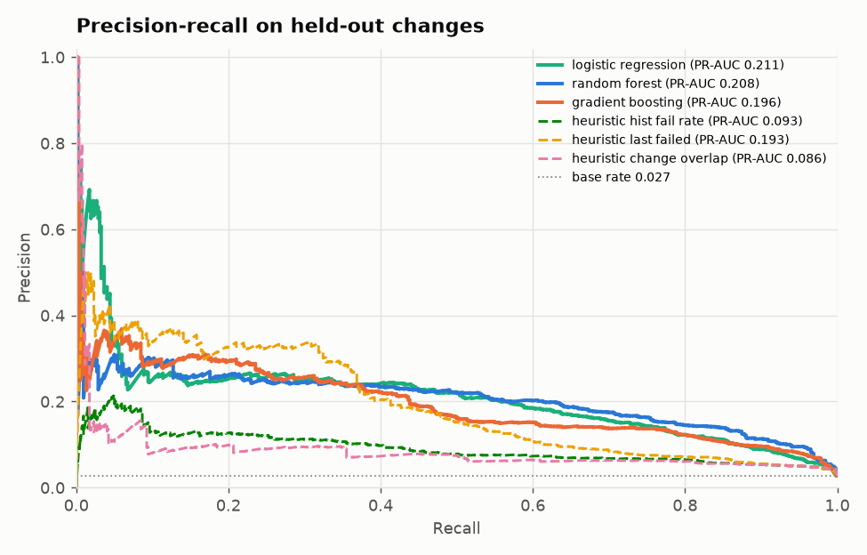
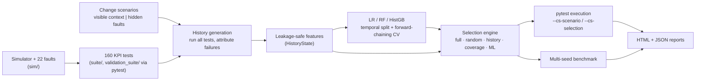

# handover-ml — CellSelect: ML-driven selection of cellular validation tests

CellSelect predicts which wireless/cellular validation tests are likely to fail for a given
code or configuration change. It then picks and orders a subset that fits an execution budget,
while keeping mandatory tests and coverage of the changed components. Every claim below comes
from a benchmark you can re-run with one command.

> **Honesty notes.** The system under test is a **deterministic behavioural simulator** of a
> cellular stack (link budget, CQI/BLER, HARQ, scheduling, RRC timers, A3 handover, back-off
> reconnection, configuration parsing) with **22 injectable, realistic software faults**. It is
> *not* RF/modem/hardware testing and makes no 3GPP-conformance claim. All datasets are
> **synthetic**. Runtimes are *nominal lab durations* from the test catalog (what the equivalent
> drive/soak/conducted test would take). Selection overhead is real measured wall-clock time.

This project complements a separate log-analysis project, which classifies failures, clusters
error patterns and summarises root causes *after* tests run. CellSelect decides *which tests to
run, and in what order*, before execution.

---

## Results (3 seeds × 120 held-out changes, measured)

Setup: for each seed, 400 simulated changes are generated in chronological order. Models train on
the first 70 % and the strategies are compared on the last 30 % (120 changes per seed, 360
total). History features use only earlier changes. Budgets are fractions of the full-suite
nominal lab time (full suite = 158 active tests, **23 959 s ≈ 6.7 h** on average over the
held-out period). A fault "detected by the full suite" is a (change, fault) pair for which at least
one test fails because of that fault (verified by single-fault re-runs). There are 78.3 such pairs
per seed on average.

| Strategy | Budget | Tests run | Runtime reduction (e2e) | Selection overhead | Fault retention (± std over seeds) | Faults missed / detected by full (per seed) | Coverage retained | Time to first fault-revealing failure |
|---|---|---|---|---|---|---|---|---|
| Random | 10% | 33.8 | 90.0% | 0 ms | 57.5% ± 1.7% | 33.4 / 78.3 | 92.3% | 1108 s |
| Historical failure rate | 10% | 38.1 | 90.0% | 7 ms | 76.6% ± 8.9% | 18.3 / 78.3 | 84.6% | 538 s |
| Coverage greedy (change-aware) | 10% | 32.6 | 90.0% | 8 ms | 62.5% ± 2.0% | 29.3 / 78.3 | 100.0% | 1259 s |
| **ML risk + coverage (CellSelect)** | 10% | 48.2 | 90.0% | 130 ms | **90.1% ± 1.8%** | **7.7** / 78.3 | 93.7% | **367 s** |
| Random | 20% | 49.8 | 80.0% | 0 ms | 73.5% ± 1.0% | 20.7 / 78.3 | 96.8% | 1914 s |
| Historical failure rate | 20% | 45.7 | 80.0% | 6 ms | 85.7% ± 4.3% | 11.0 / 78.3 | 94.6% | 982 s |
| Coverage greedy (change-aware) | 20% | 53.6 | 80.0% | 13 ms | 78.7% ± 1.2% | 16.7 / 78.3 | 100.0% | 1737 s |
| **ML risk + coverage (CellSelect)** | 20% | 76.9 | 80.0% | 139 ms | **93.9% ± 2.3%** | **4.7** / 78.3 | 96.8% | **412 s** |
| Random | 30% | 64.1 | 70.0% | 0 ms | 82.4% ± 0.3% | 13.8 / 78.3 | 98.7% | 2470 s |
| Historical failure rate | 30% | 55.7 | 70.0% | 6 ms | 91.8% ± 4.6% | 6.7 / 78.3 | 97.1% | 1359 s |
| Coverage greedy (change-aware) | 30% | 65.8 | 70.0% | 16 ms | 86.7% ± 1.3% | 10.3 / 78.3 | 100.0% | 2339 s |
| **ML risk + coverage (CellSelect)** | 30% | 100.7 | 70.1% | 144 ms | **95.9% ± 4.4%** | **3.0** / 78.3 | 98.6% | **502 s** |
| Random | 50% | 92.3 | 50.0% | 0 ms | 93.2% ± 2.2% | 5.3 / 78.3 | 99.8% | 3321 s |
| Historical failure rate | 50% | 74.3 | 50.0% | 6 ms | 94.6% ± 1.4% | 4.3 / 78.3 | 98.5% | 2071 s |
| Coverage greedy (change-aware) | 50% | 79.3 | 50.1% | 18 ms | 86.3% ± 2.8% | 10.7 / 78.3 | 100.0% | 2452 s |
| **ML risk + coverage (CellSelect)** | 50% | 128.5 | 50.1% | 146 ms | **98.7% ± 1.2%** | **1.0** / 78.3 | 100.0% | **582 s** |

Full suite: 100 % retention by definition. Its first fault-revealing failure arrives after
3573 s on average (catalog order).

**Reading the table:**

* At a **20 % budget (80 % less lab time)** CellSelect keeps **93.9 %** of the full suite's fault
  detections. It misses 4.7 per seed, against 11.0 for the best baseline (historical failure rate)
  and 20.7 for random.
* At a **10 % budget** the gap is largest: **90.1 %** vs. 76.6 % for the historical failure rate.
* Cost-aware prioritisation surfaces the first fault-revealing failure after **367–582 s** of lab
  time. Baselines take 538–3321 s and the full suite takes 3573 s.
* The ML strategy's overhead (feature computation, random-forest inference with per-tree
  uncertainty, greedy selection) averaged **130–146 ms** per change. Against hours of lab time this
  is negligible: end-to-end reductions above already include it.
* Change-aware coverage greedy keeps 100 % coverage but detects fewer faults. Spreading tests over
  every component is not the same as finding faults. Its retention at 50 % (86.3 %) is not higher
  than at 30 % (86.7 %), because the greedy order changes when larger tests fit.
* The historical-failure-rate baseline varies a lot between seeds (± 8.9 pp at 10 %).
  CellSelect's spread is ± 1.8 pp.

### Ablation: where does the gain come from?

| Variant | 10 % | 20 % | 30 % | 50 % | Coverage @10 % |
|---|---|---|---|---|---|
| ML risk + coverage (full CellSelect) | 90.1% | 93.9% | 95.9% | 98.7% | 93.7% |
| ML risk, cost-aware greedy, **no coverage term / guard** | 90.0% | 93.1% | 95.5% | 98.7% | 89.0% |
| ML probability ranking only (no cost awareness) | 88.9% | 93.6% | 94.8% | 95.7% | 78.0% |

Most of the fault-detection gain comes from the **ML risk estimate combined with cost-aware
(risk per second) selection**. The coverage term and guard add little retention (≤ 0.8 pp), but
they keep coverage and guarantee every changed component is exercised. Ranking by probability
alone is clearly worse at larger budgets and keeps much less coverage.

### Failure-prediction models (held-out temporal period, mean over 3 seeds)

| Model | PR-AUC | ROC-AUC | Precision | Recall | F1 | TP | FP | FN | TN |
|---|---|---|---|---|---|---|---|---|---|
| Logistic regression | 0.189 ± 0.027 | 0.891 | 0.211 | 0.380 | 0.267 | 542 | 2055 | 872 | 53411 |
| **Random forest** (selected by CV on every seed) | 0.187 ± 0.026 | **0.911** | 0.213 | 0.420 | 0.268 | 592 | 2322 | 822 | 53144 |
| Gradient boosting (HistGB) | 0.147 ± 0.035 | 0.883 | 0.179 | 0.414 | 0.237 | 582 | 3034 | 832 | 52432 |
| Heuristic: last run failed | 0.174 ± 0.029 | 0.852 | 0.289 | 0.271 | 0.279 | 386 | 942 | 1028 | 54524 |
| Heuristic: historical failure rate | 0.096 ± 0.015 | 0.820 | 0.124 | 0.261 | 0.164 | 372 | 2548 | 1042 | 52918 |
| Heuristic: change/component overlap | 0.073 ± 0.010 | 0.789 | 0.084 | 0.319 | 0.133 | 454 | 4922 | 960 | 50544 |

Base failure rate is 2.5 %, so a random scorer has PR-AUC ≈ 0.025. Thresholds are tuned on the
forward-chaining CV folds only, never on the test period.

**Honest interpretation:** per-execution failure prediction is hard here. Many failures come from
*new* faults that history cannot predict. The models beat the single best heuristic on ROC-AUC
(0.91 vs 0.85) but only slightly on PR-AUC (0.19 vs 0.17). The strategy-level gain comes from
using calibrated-enough probabilities *inside* a cost-aware, coverage-constrained selector, not
from an especially accurate classifier. Permutation importance ranks `last_failed`,
`runs_since_fail`, `category_prev_fail_frac`, `hist_fail_rate_when_overlap` and
`lines_changed_log` highest. `firmware_branch` also shows a small importance (0.007), but it has
no causal link to faults in the simulator, so treat it as a spurious correlation that a larger
dataset should remove.

### Plots and reports (generated by the commands below)

| | |
|---|---|
|  |  |
|  |  |
|  |  |

* Benchmark report: [`results/benchmark/benchmark_report.html`](results/benchmark/benchmark_report.html)
  (machine-readable: `benchmark_results.json`, `summary.csv`, `summary_per_seed.csv`,
  `selection_metrics_all.csv`)
* Example run report (mobility change with 2 hidden faults, ML strategy at 20 %, executed via
  pytest): [`reports/demo/run_report.html`](reports/demo/run_report.html) + `run_report.json`
* Clean-change example (no faults; retention correctly reported as *n/a*):
  [`reports/demo_clean/run_report.html`](reports/demo_clean/run_report.html)
* Model evaluation: `reports/evaluation/` (PR curves, confusion matrix, permutation importance)

---

## Architecture



Detailed diagram, data flow and design rationale: [`docs/architecture.md`](docs/architecture.md).
Dataset columns: [`docs/data_dictionary.md`](docs/data_dictionary.md).

```
src/cellselect/
  sim/            behavioural cellular simulator + fault catalog (radio, scheduler, transport, rrc,
                  mobility, session, power, confparser, bands, faults, context)
  suite/          test catalog (IDs, tags, durations), KPI checks, independent reference oracles,
                  in-process runner + fault attribution
  data/           change scenarios, chronological dataset generation, leakage-safe features
  ml/             model zoo, training (temporal split, forward-chaining CV), evaluation, predictor
  selection/      strategies, mandatory tests, fallbacks, per-test explanations
  execution/      pytest subprocess runner
  benchmark/      metrics + multi-seed benchmark
  reporting/      matplotlib charts, HTML reports
  orchestrate.py  select / compare workflows;  cli.py  command-line interface
validation_suite/ pytest suite (160 simulated tests) + conftest plugin (scenario, selection, results)
tests/            41 unit / integration tests for the project itself
configs/          experiment.json (main benchmark), smoke.json (CI)
scripts/          fault_matrix.py (calibration), probe_kpis.py, results_table.py
docs/             architecture.md, data_dictionary.md
.github/workflows/ci.yml
```

### The simulated validation suite

160 tests in 10 categories, generated from 25 parameterised templates: smoke (5,
critical), signal quality (22), throughput (38), latency/loss (20), connection (14), handover (24),
network interruption (11), configuration (16), regression (4), stability (6). Each test has a
unique ID (e.g. `HO-INTRA-007`), category, component coverage tags, parameters, and a nominal lab
duration (5 s config check up to 3600 s soak). Full-suite nominal lab time is 24 559 s (6.8 h).

Checks compare simulator KPIs against **independent reference oracles** (`suite/reference.py`), so
a fault in the simulator cannot silently move its own expected value. Faults only manifest under
specific conditions. For example, `F_TTT_UNITS` (time-to-trigger counted in 40 ms periods) only
breaks high-speed handovers. `F_CQI_OFFSET` only affects estimated SINR > 18 dB.
`F_MEMORY_LEAK` only shows in long or bursty soak tests. `F_N311` only matters for fades close to
T310. So detection depends on test parameters, not random labels. Some faults are detected
outside their own component (e.g. CQI faults break configuration-change throughput checks), which
models hidden dependencies. `python scripts/fault_matrix.py` prints the fault → detecting-tests
matrix and the fault-free noise rates.

Realism knobs: lab environment (device noise figure, interference, temperature) varies per change
and makes marginal tests occasionally fail without faults (≈ 9 % of failures are such *noise*).
Unfixed faults persist across changes. A collateral-fault probability injects faults into
undeclared neighbouring components. One test family (`HO-PP-*`) is introduced late, which
exercises the insufficient-history fallback.

### Selection engine (`selection/engine.py`)

| Strategy | Logic |
|---|---|
| `full` | Every test |
| `random` | Random order, fill budget (5 repeats in the benchmark) |
| `history` | Rank by smoothed historical failure rate, fill budget |
| `coverage` | Change-aware *additional greedy*: max newly-covered weighted items per second (changed components ×5, neighbours ×2) |
| `ml` | Greedy on `(p·residual_risk + λ·coverage_gain) / duration`, then execute by risk density `p/duration` |

Rules for **all** budgeted strategies: critical tests are always selected and run first. If they
alone exceed the budget they still run, and a warning is emitted.

ML-strategy **safe fallbacks** (each recorded in `fallbacks`/`warnings` and in the per-test reasons):

1. **Insufficient history:** tests with fewer than `min_history` (10) runs execute
   unconditionally. They are triggered in 8.3 % of held-out changes (the late `HO-PP` family).
2. **Coverage guard:** every changed component gets ≥ 1 test, allowing up to 10 % budget overrun.
   If that is impossible, a warning names the uncovered component.
3. **Model uncertainty:** if the per-tree std of the random forest is ≥ 0.30, risk is raised to
   `p + 0.5·std` (an upper-confidence bound).
4. **Scenario-level fallback to coverage-greedy:** used when the model artifact is missing,
   incompatible or fails at inference, or when the change type/area was never seen in training.
5. **High-risk exclusion:** any test predicted high-risk but excluded by budget is listed as a
   warning.

Every test, selected or not, carries human-readable reasons. Example from the demo:

```
   7  HO-INTRA-010   38   0.233  coverage guard: covers changed component mobility.measurement (best risk/cost of 33 candidates, p=0.233)
   8  HO-INTRA-007   46   0.259  high predicted failure risk p=0.259 (uncertainty-adjusted 0.435); expected new detection 0.201; coverage gain 0.000; utility 15.891/h (greedy pick 3)
```

### Leakage prevention

* Selection only ever sees `ChangeContext`. Injected faults live in a separate `ground_truth`
  block that only the simulator reads.
* `HistoryState.features_for_change(t)` is computed **before** outcomes of change *t* are
  recorded. `tests/test_features_leakage.py` mutates current and future outcomes and asserts
  features are unchanged, and also re-derives stored features by replaying history.
* Splits are by change and chronological: train on the past, test on the future.
  Hyper-selection uses forward-chaining CV folds inside the training period.
* `test_id` and outcome-derived columns (`failure_kind`, `message`, `wall_s`) are never features.
  The feature list is explicit and unit-tested.

### Metric definitions

* Runtime reduction = (full − selected) / full, in nominal lab seconds. The **end-to-end** version
  adds measured selection overhead to the selected time.
* Fault-detection retention = faults detected by the selection ÷ faults detected by the full suite
  on the same scenarios. It is pooled over scenarios. Scenarios where the full suite detects
  nothing have an undefined ratio (`None`) and are excluded from the denominator, never counted as
  0 or 1. Absolute missed counts are always reported.
* A test *detects* fault *f* if it fails with *f* alone and passes without faults under the
  identical seed and environment.

---

## Setup

Requires Python ≥ 3.10. Verified on Windows 11, Python 3.11.9, with the exact versions in
`requirements.txt` (pandas 3.0, scikit-learn 1.9, numpy 2.4, matplotlib 3.11, pytest 9.1). The
pinned versions need Python ≥ 3.11. On 3.10 use `pip install -e .`, which uses compatible ranges.

```bash
python -m venv .venv
```

```bash
.venv/Scripts/activate        # Windows (Git Bash: source .venv/Scripts/activate); Linux/macOS: source .venv/bin/activate
```

```bash
pip install -r requirements-dev.txt
```

```bash
pip install -e . --no-deps
```

## Commands (all verified on this machine)

Each command also works as `python -m cellselect ...`. `--config` is a global option, so it goes
before the sub-command.

```bash
cellselect catalog --out data/catalog                                         # export the 160-test catalog
```

```bash
cellselect --config configs/experiment.json generate --out data/history --seed 0   # ~90 s, 62 080 executions
```

```bash
cellselect --config configs/experiment.json train --data data/history --out artifacts/models
```

```bash
cellselect evaluate --data data/history --models artifacts/models --out reports/evaluation
```

```bash
cellselect scenario --seed 5 --area mobility --type feature --out scenarios/demo_mobility.json   # add --reveal to print hidden faults
```

```bash
cellselect --config configs/experiment.json select --scenario scenarios/demo_mobility.json --budget-fraction 0.2 --out reports/demo/selection.json   # preview only
```

```bash
cellselect run --scenario scenarios/demo_mobility.json --selection reports/demo/selection.json --results reports/demo/selected_results.json   # executes via pytest
```

```bash
cellselect --config configs/experiment.json compare --scenario scenarios/demo_mobility.json --budget-fraction 0.2 --time-scale 0.0005 --out reports/demo
```

```bash
cellselect --config configs/experiment.json benchmark --out results/benchmark --jobs 3   # ~4 min on a laptop
```

```bash
cellselect report --benchmark-dir results/benchmark                           # rebuild HTML from results
```

Other useful commands:

```bash
pytest -q                                                    # project tests (41)
```

```bash
pytest validation_suite -q                                   # the simulated suite, fault-free build: 160 pass
```

```bash
pytest validation_suite -q --cs-scenario scenarios/demo_mobility.json   # same suite against the faulty build
```

```bash
python scripts/fault_matrix.py --envs 20 --fault-envs 5      # calibration: fault -> detecting tests
```

```bash
cellselect --config configs/smoke.json benchmark --out results/ci/benchmark   # CI-sized benchmark (~1 min)
```

`select` also accepts `--budget-seconds 3600` and `--strategy {full,random,history,coverage,ml}`.
`compare --time-scale X` makes each test sleep `nominal_duration × X`, so pytest wall-clock also
reflects lab time. In the demo, 0.0005 gave 3.40 s for the selected suite vs 13.57 s for the full
suite.

### Demo walkthrough (what `compare` printed)

```
selected 77/160 tests; nominal runtime reduction (e2e) 80.1%; measured pytest wall 3.40s vs 13.57s full
faults detected: selected 2 / full 2 (missed 0; retention 100.0%)
strategy   tests  time% detected missed
full         160 100.0%        2      0
random        63  20.0%        2      0
history       46  20.0%        2      0
coverage      55  20.0%        1      1
ml            77  19.9%        2      0
```

The hidden faults were `F_L3_FILTER` (declared component) and `F_N311`. `F_N311` is a collateral
fault in `rrc.timers`, a component the change did **not** declare. The report shows predicted risk
(bars, before execution) separately from confirmed pytest failures (✕, after execution). It also
includes a determinism check: the selected tests' outcomes match the full pytest run. One
scenario is an anecdote; the benchmark above is the evidence.

## Testing and CI

* `tests/` contains 41 tests: simulator fault semantics, catalog integrity, "every fault is
  detectable", attribution, leakage (feature invariance, replay equality, chronological folds),
  metric edge cases (zero denominators), selection contracts (budget, critical tests, all
  fallbacks, explanations, reproducibility), pytest ↔ in-process parity, and a full CLI
  end-to-end run. **All 41 pass locally (≈ 45 s).**
* `.github/workflows/ci.yml` runs four stages:
  1. ruff lint and format check;
  2. the test matrix (Ubuntu + Windows × Python 3.11/3.12) plus the 160-test simulated suite;
  3. a smoke pipeline: generate → train → scenario → select → pytest run → compare;
  4. the lightweight benchmark (`configs/smoke.json`), with reports uploaded as artifacts.

  It needs no secrets or paid services. The individual CI commands were executed locally on
  Windows. The workflow itself has not run on GitHub yet; it will on the first push.

## Limitations

* **Synthetic world.** The fault model, durations and noise were designed and calibrated by hand
  (`scripts/fault_matrix.py`). Absolute numbers will not transfer to a real modem lab. What does
  transfer is the methodology: the leakage controls, the attribution protocol and the
  baseline/ablation comparison.
* History assumes a **nightly full run**, so every test has an outcome after each change. In a
  pure selective-execution deployment, history would be censored to selected tests. The benchmark
  does not model this feedback loop.
* Faults detected by the full suite are counted per (change, fault). A fault persisting over
  several changes counts once per change.
* The in-process runner is used for bulk data and the benchmark. pytest is used for `run`/`compare`
  and CI. Parity is tested, but the benchmark's 360 × 7 strategy evaluations are not each launched
  through pytest.
* Per-test uncertainty uses random-forest tree disagreement. If a non-ensemble model is chosen,
  only the scenario-level and history-based fallbacks apply.
* Failure prediction is modest in absolute terms (PR-AUC ≈ 0.19), and a small spurious feature
  (`firmware_branch`) carries some importance.
* Measured overhead (≈ 0.13–0.15 s per change) is from one Windows laptop. It scales with catalog
  size: feature computation is O(history × tests) and the greedy is O(selected × tests).

## License

MIT. See `LICENSE`.
